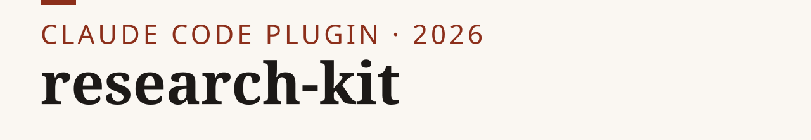
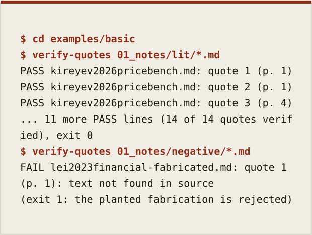
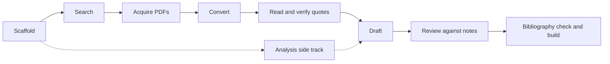

<p><picture><source media="(prefers-color-scheme: dark)" srcset="assets/banner-dark.svg"></picture></p>

**Turn a reading list into source-grounded notes, check a draft against them, and build a paper.**

[Catalog](CATALOG.md) · [Install guide](INSTALL.md) · [Workflow](docs/workflow.md) · [What is verified](docs/verification.md) · [Changelog](CHANGELOG.md)

[](LICENSE) [](CHANGELOG.md)

<picture><source media="(prefers-color-scheme: dark)" srcset="assets/transcript-dark.svg"></picture>

Early-stage plugin **0.1.3**: 7 skills, 4 agent roles, 8 command-line tools and
project, Python and R templates. Install the Claude Code plugin, or the documented
Codex adapter into one project. The skills and roles are Markdown instructions; the
helpers are eight Python programs. Reading a skill does not execute a tool.

## Install

```text
/plugin marketplace add nik110403/research-kit
/plugin install research-kit@research-kit
```

Then ask Claude to start a research project, search the literature, or verify notes.
Command-line dependencies still need to be available; see [INSTALL.md](INSTALL.md)
for tool paths, selective installation and existing-settings precautions.

For Codex, from this checkout run `python3 scripts/install-codex.py --project
/absolute/path/to/project` (PowerShell: `python .\scripts\install-codex.py --project
C:\path\to\project`). This copies one local skill to
`.agents/skills/research-kit/`; it is an adapter with tested installation and local
helpers, not evidence of live Codex discovery or imported Claude permissions.

## What you get

| Kind | Name | What it does |
|---|---|---|
| Skill | [new-research-project](plugins/research-kit/skills/new-research-project/SKILL.md) | Scaffold a numbered project tree from a question |
| Skill | [literature-search](plugins/research-kit/skills/literature-search/SKILL.md) | Search providers, save a reading list with a receipt |
| Skill | [pdf-to-markdown](plugins/research-kit/skills/pdf-to-markdown/SKILL.md) | Convert PDFs to page-marked Markdown |
| Skill | [literature-notes](plugins/research-kit/skills/literature-notes/SKILL.md) | Write a structured note with page-pinned quotes |
| Skill | [review-against-notes](plugins/research-kit/skills/review-against-notes/SKILL.md) | Review a draft against the notes |
| Skill | [paper-build](plugins/research-kit/skills/paper-build/SKILL.md) | Check the bibliography and build PDF or HTML |
| Skill | [analysis-pipeline](plugins/research-kit/skills/analysis-pipeline/SKILL.md) | Set up and run a repeatable analysis |
| Agent | [source-reader](plugins/research-kit/agents/source-reader.md) | Read one source into a note |
| Agent | [claim-checker](plugins/research-kit/agents/claim-checker.md) | Judge whether notes support cited claims |
| Agent | [skeptic](plugins/research-kit/agents/skeptic.md) | Challenge the strongest claims of a draft |
| Agent | [pipeline-runner](plugins/research-kit/agents/pipeline-runner.md) | Run a trusted analysis pipeline and report |
| Tool | [verify-quotes](plugins/research-kit/bin/verify-quotes) | Match each quote, on its stated page, against a markdown copy of the source (hash enforced with `--strict`) |
| Tool | [lit-search](plugins/research-kit/bin/lit-search) | Literature search with provider receipts |
| Tool | [pdf2md](plugins/research-kit/bin/pdf2md) | PDF to Markdown with page markers |
| Tool | [check-claims](plugins/research-kit/bin/check-claims) | Check each cited note (runs `verify-quotes` on it) and flag uncited or unverified claims; does not judge meaning |
| Tool | [check-bib](plugins/research-kit/bin/check-bib) | Check bibliography structure and citation coverage |
| Tool | [build-paper](plugins/research-kit/bin/build-paper) | Build PDF, HTML or DOCX with pandoc |
| Tool | [new-project](plugins/research-kit/bin/new-project) | Scaffold a research project |
| Tool | [new-pipeline](plugins/research-kit/bin/new-pipeline) | Scaffold an R or Python pipeline |

The [complete catalog](CATALOG.md) lists every component's inputs, outputs and
dependencies; the [adapter guide](docs/adapters.md) covers manual use with other assistants.

## 30-second example

The transcript above runs the offline quote check on the bundled example. The
sources are bundled, so it needs neither PDF software nor an API key.

To reproduce it, clone the [repository](https://github.com/nik110403/research-kit) and, with Python 3.9+, run from its root:

```sh
cd examples/basic
python3 ../../plugins/research-kit/bin/verify-quotes --strict 01_notes/lit/*.md
python3 ../../plugins/research-kit/bin/verify-quotes --strict 01_notes/negative/*.md
```

The first command should print **14 of 14 PASS** and exit 0. The second should
report the fabricated quotation as **FAIL** and exit 1; that failure is expected.
See the [example walkthrough](examples/basic/RUN.md) and
[source attribution](examples/basic/SOURCES.md). Every quote is matched, on a stated page, against a markdown copy of the source; `--strict` also requires that copy's recorded hash to match, which catches accidental edits but not tampering by someone with write access (see [what is verified](docs/verification.md)). That checks converted
text, not the original PDF and not whether a claim follows from the quotation.

## How it works

Enter at any stage for which you have the inputs; the tools handle mechanical
checks and the assistant roles return text for the main session to save. Details
and evidence boundaries are in [docs/workflow.md](docs/workflow.md).



## Configuration

- Python helpers require Python 3.9+ and use the standard library only. Search needs internet access. Semantic
  Scholar can reject keyless requests; an optional `SEMANTIC_SCHOLAR_API_KEY`
  helps, and receipts report provider failures and partial coverage.
- PDF conversion needs Poppler's `pdftotext`; scans may need `ocrmypdf`, encrypted
  files `qpdf`. `pdf2md` refuses `--engine docling` (removed in 0.1.3: its output is one
  block marked page 1, which breaks page pinning). Recheck page pins against the PDF.
- Paper builds need Python 3.9+ and pandoc; PDF prefers Typst then XeLaTeX, and
  falls back explicitly to HTML if neither exists. Windows invocation is supported
  through `python`/`py -3`; CI covers helpers, not a live Codex session.
- R pipelines need R; Python pipelines can use `uv`. Running a pipeline executes
  project code with your permissions. Model steps also depend on your assistant's
  access and may incur its usual costs. No native non-Claude integration or
  cross-platform performance guarantee is claimed.

## Contributing

[CONTRIBUTING.md](CONTRIBUTING.md) covers checks, privacy and licensing.

## License

Code, skills, agents and templates are [MIT](LICENSE). Documentation under
`docs/` is [CC BY 4.0](LICENSE-docs); bundled papers and conversions retain their
authors' attribution. See the [licensing map](LICENSING.md).
